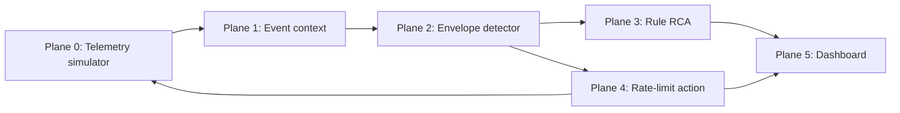

# SYN-City

SYN-City is a deterministic observability demo for match-night traffic: it learns context-conditioned KPI envelopes, suppresses expected event traffic, detects unexplained credential stuffing and checkout-path faults, then shows a simulated response and RCA in one replay dashboard.

## Run

Backend (from `backend`): activate `.venv`, run `python -m app.train` if `models/` is absent, then `uvicorn app.main:app --reload`. Frontend (from `frontend`): run `pnpm install` then `pnpm dev`.

The replay shows three verdicts: a context-aware suppression for the M-217 merch drop, credential stuffing on auth with an 80% simulated edge rate-limit and MTTR, and a context-free checkout latency/error fault with a rule-based RCA. Current detector mode is `DETECTOR=envelope` (set `DETECTOR=rules` for degraded mode).

## Not yet built

- Stage 4 deep symptom breadth: LSTM-AE, control-plane counters, and silence detector.
- Live LLM narrative: keys are reserved for later but no provider is called.
- Real git-diff localization: the checkout RCA is a scripted narrative demonstrating the required output format.
