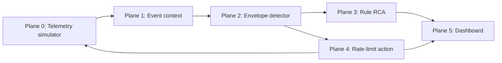

# SYN-City

SYN-City is a deterministic observability demo for match-night traffic: it learns context-conditioned KPI envelopes, suppresses expected event traffic, detects unexplained credential stuffing and checkout-path faults, then shows a simulated response and RCA in one replay dashboard.

## Run

Backend (from `backend`): activate `.venv`, run `python -m app.train` if `models/` is absent, then `uvicorn app.main:app --reload`. Frontend (from `frontend`): run `pnpm install` then `pnpm dev`.

The replay shows a context-aware M-217 suppression, credential stuffing with an 80% simulated edge rate-limit, a SYN flood, traffic-independent memory leak, telemetry silence, and a checkout retry storm. Attack discrimination fuses source entropy, flow similarity, machine-regular timing, auth failures, and crowd coherence; fault discrimination fuses retry amplification, memory slope, and deploy correlation. Stage 4 ships a deterministic CPU torch LSTM autoencoder plus Isolation Forest/POT scoring and a liveness guard. RCA narratives use Groq -> Gemini -> rules when keys are present in `backend/.env`, and degrade gracefully to rules without them. Current detector mode is `DETECTOR=envelope` (set `DETECTOR=rules` for degraded mode).

## Not yet built

- Full action machinery and automated regression tests.

## External validation

The committed normal-traffic CSV benchmark currently reports a 7.0000% false-positive rate (350 alerts across 5,000 row-minutes), dominated by `auth_failure_ratio`; reproduce it with `cd backend && python -m app.eval_csv`. The CSV loader median-normalizes volume, latency, and count channels to scenario baselines while retaining scale-free ratios. To add it as clean training history only, run `python -m app.train --csv backend/data/context_aware_observability_sample_5000_v2.csv`.
